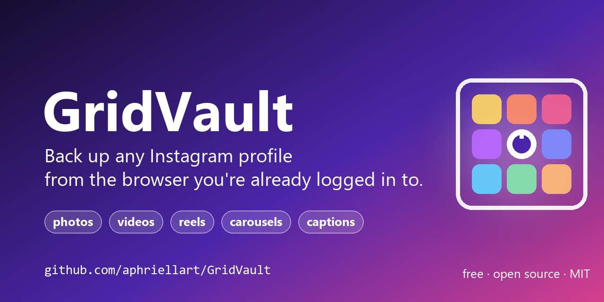

<p align="center">
  
</p>

<h1 align="center">GridVault</h1>

<p align="center">
  <b>Tool gratis & open-source untuk download dan backup profil Instagram.</b><br>
  Simpan semua foto, video, reels, dan carousel dari akun Instagram dalam resolusi penuh, lengkap dengan caption dan metadata,<br>
  memakai browser yang sudah Anda pakai login. Tanpa password, tanpa API key, tanpa layanan berbayar.
</p>

<p align="center">
  <a href="LICENSE"></a>
  
  
  <a href="https://github.com/aphriellart/GridVault/stargazers"></a>
</p>

<p align="center">
  <a href="#cara-cepat">Cara cepat</a> ·
  <a href="#kenapa-gridvault">Kenapa GridVault</a> ·
  <a href="#dipakai-dengan-claude-code">Skill Claude Code</a> ·
  <a href="#faq">FAQ</a> ·
  <a href="README.md">English</a>
</p>

---

GridVault menggulir profil Instagram **di browser Anda sendiri**, mencatat postingan
yang dimuat halaman, lalu menyimpannya sebagai manifest JSON kecil. Script Python
kecil kemudian mengunduh semua file ke folder yang rapi. Karena memakai sesi browsing
biasa, bukan membombardir API Instagram, GridVault tetap jalan saat downloader berbasis
API kena `429 Too Many Requests` atau `feedback_required`.

```
downloads/<username>/
├── profile_pic.jpg
├── manifest.json                              # likes, views, caption, lokasi, tanggal
└── posts/
    ├── 2024-05-01_10-22-33_C6abcXYZ_1.jpg     # slide carousel: _1, _2, ...
    ├── 2024-05-01_10-22-33_C6abcXYZ_2.mp4
    ├── 2024-05-01_10-22-33_C6abcXYZ.txt       # caption
    └── ...
```

> **Uji nyata:** profil berisi 433 postingan → 394 postingan yang tampil → **613 foto + 156 video (654 MB) dalam sekitar 5 menit**, tanpa diblokir.

## Fitur

- 📸 **Foto, video, reels, dan carousel** dalam resolusi tertinggi dari Instagram (gambar 1080 px, MP4 asli)
- 📝 **Caption** sebagai file `.txt` dan **`manifest.json`** lengkap (likes, komentar, views, lokasi, waktu)
- 🤝 **Postingan kolaborasi** yang tampil di grid, dan opsional postingan tempat akun di-**tag**
- 🔁 **Bisa dilanjutkan:** jalankan ulang dan file yang sudah ada akan dilewati
- 🔒 **Privat:** password dan cookie tidak pernah keluar dari komputer Anda; hanya CDN Instagram yang dihubungi
- 🪶 **Tanpa dependensi** untuk mode utama: cukup browser dan library bawaan Python
- 🎞️ **Mode instaloader** opsional untuk **stories dan highlights**
- 🤖 Bisa dipakai sebagai **skill [Claude Code](https://claude.com/claude-code)**: cukup bilang *"backup instagram.com/natgeo"*

## Cara cepat

**Butuh:** Python 3.10+ dan Chrome (atau Edge/Brave/browser Chromium lain) yang sudah login Instagram.

```bash
git clone https://github.com/aphriellart/GridVault
cd GridVault
```

**1 · Kumpulkan.** Buka `https://www.instagram.com/<username>/`, tekan **F12 → Console**,
tempel isi [`scripts/chrome_collect.js`](scripts/chrome_collect.js), tekan Enter, lalu jalankan:

```js
__ig.start({reels: true, autosave: true})
```

```
[GridVault] collecting @example... do not click in this tab until it says done.
[GridVault] posts: scroll #12 · 144/433 posts · 251 files · 45s
[GridVault] done: 394/433 posts, 768 files in 260s.
[GridVault] Saved ig_example_manifest.json (804 KB, 394 posts) to your Downloads folder
```

> Chrome mungkin meminta Anda mengetik `allow pasting` dulu, dan Instagram menampilkan
> peringatan besar **"Stop!"**. Peringatan itu benar: jangan pernah menempel kode yang tidak
> Anda pahami. Kolektor ini sekitar 250 baris yang mudah dibaca. Ia hanya membaca data yang
> memang diterima halaman dan tidak mengirim apa pun ke mana pun.

**2 · Unduh.**

```bash
python scripts/download_manifest.py ~/Downloads/ig_<username>_manifest.json --out ./downloads
```

Jalankan segera setelah mengumpulkan, karena link CDN Instagram kedaluwarsa dalam beberapa hari.

| Opsi kolektor | Fungsi |
|---|---|
| `reels: true` | ikut memindai tab **Reels** |
| `tagged: true` | ikut memindai tab **Tagged** (disimpan ke `tagged/`) |
| `autosave: true` | otomatis mengunduh manifest saat selesai |

Perintah lain: `__ig.status()`, `__ig.stop()`, `__ig.save()`.

## Kenapa GridVault

| | **GridVault** (mode browser) | Downloader berbasis API |
|---|---|---|
| Login | sesi browser yang sudah ada | password atau file session |
| Diblokir Instagram | jarang: perilakunya seperti Anda menggulir | sering `429` / `feedback_required`* |
| Postingan kolaborasi di grid | ✅ | tergantung |
| Instalasi | tidak perlu (browser + Python bawaan) | paket Python |
| Stories & highlights | ❌ (pakai mode instaloader) | ✅ |
| Otomatis penuh tanpa browser | ❌ butuh tab browser terbuka | ✅ |

\* Dalam pengujian kami pada November 2026, instaloader 4.16 langsung ditolak tanpa login,
dan dengan session valid membalas `feedback_required` atau feed kosong. GridVault, di komputer
dan akun yang sama, berhasil mengambil semuanya.

## Dipakai dengan Claude Code

GridVault dilengkapi [`SKILL.md`](SKILL.md), jadi [Claude Code](https://claude.com/claude-code)
bisa menjalankan seluruh alurnya untuk Anda:

```bash
git clone https://github.com/aphriellart/GridVault ~/.claude/skills/gridvault
```

Sambungkan extension [Claude in Chrome](https://claude.com/chrome), lalu minta
*"download semua postingan instagram.com/natgeo"*. Claude akan membuka profil di tab baru,
menjalankan kolektor, menyimpan manifest, mengunduh semuanya, dan melaporkan hasilnya.

## Mode instaloader (stories & highlights)

Instagram sangat membatasi sesi otomatis, jadi pakai mode ini hanya untuk yang tidak bisa dilakukan mode browser.

```bash
pip install -r requirements.txt
python scripts/ig_session_from_cookie.py <username_anda>   # sekali saja, tanpa password
python scripts/ig_download.py <target> --stories --highlights --login <username_anda> --out ./downloads
```

`ig_session_from_cookie.py` meminta Anda menempel cookie `sessionid` (F12 → Application →
Cookies) ke kolom tersembunyi, lalu membaca cookie lainnya dari clipboard setelah Anda
menjalankan `copy(document.cookie)` di Console. File session memberi akses ke akun Anda:
simpan baik-baik, dan logout dari Instagram untuk mematikannya. Sebaiknya pakai akun sekunder.
Jalankan `python scripts/ig_download.py --help` untuk semua opsi.

## FAQ

**Gratis? Perlu API key?**
Ya, gratis dan berlisensi MIT. Tidak perlu API key atau layanan pihak ketiga.

**Perlu password Instagram saya?**
Tidak. Mode browser memakai sesi yang sudah login, dan tidak ada yang dikirim ke mana pun.

**Bisa download akun privat?**
Hanya akun yang diikuti akun Anda, persis seperti yang bisa Anda lihat di aplikasi.

**Kenapa jumlah yang terunduh lebih sedikit dari angka di profil?**
Postingan yang diarsipkan, disembunyikan, atau dibatasi tetap dihitung Instagram tapi tidak
tampil di grid, sehingga tidak bisa diambil. `manifest.json` mencatat postingan yang ada di grid
tapi tidak tertangkap.

**Jalan di Mac dan Linux?**
Seharusnya bisa: kolektor berjalan di browser Chromium mana pun dan downloader hanya Python
biasa tanpa dependensi. Sudah diuji di Windows 11 dengan Chrome; laporan dari platform lain
sangat diterima.

**Instagram berubah dan tool ini berhenti bekerja.**
Silakan [buka issue](https://github.com/aphriellart/GridVault/issues/new/choose) beserta output
Console. Aplikasi web Instagram memang sering berubah.

## Penggunaan yang bertanggung jawab

GridVault untuk **arsip pribadi**: mencadangkan akun Anda sendiri, atau menyimpan konten publik
untuk referensi pribadi atau riset. Kontennya milik pembuatnya. Jangan diunggah ulang, dijual, atau
disebarkan tanpa izin, jangan dipakai untuk melecehkan siapa pun, dan patuhi Ketentuan Penggunaan
Instagram serta hukum yang berlaku di tempat Anda. Pengumpulan otomatis bisa melanggar ketentuan
Instagram dan membuat akun dibatasi sementara; risiko penggunaan ada pada Anda.

GridVault tidak berafiliasi dengan, didukung, atau disponsori oleh Instagram maupun Meta.

## Kontribusi

Laporan bug, perbaikan, dan terjemahan sangat diterima. Lihat [CONTRIBUTING.md](CONTRIBUTING.md).
Kalau GridVault berhasil menyelamatkan kenangan Anda, **beri ⭐ agar orang lain juga bisa menemukannya.**

## Lisensi

[MIT](LICENSE)
