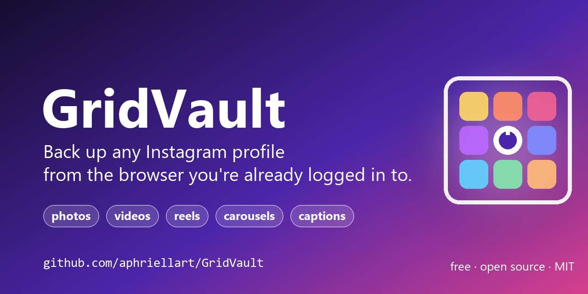

<p align="center">
  
</p>

<h1 align="center">GridVault</h1>

<p align="center">
  <b>Free, open-source Instagram profile downloader & backup tool.</b><br>
  Save every photo, video, reel and carousel from an Instagram account, in full resolution, with captions and metadata,<br>
  using the browser you're already logged in to. No password, no API key, no paid service.
</p>

<p align="center">
  <a href="LICENSE"></a>
  
  
  <a href="https://github.com/aphriellart/GridVault/stargazers"></a>
</p>

<p align="center">
  <a href="#quick-start">Quick start</a> ·
  <a href="#why-gridvault">Why GridVault</a> ·
  <a href="#use-with-claude-code">Claude Code skill</a> ·
  <a href="#faq">FAQ</a> ·
  <a href="README.id.md">Bahasa Indonesia</a>
</p>

---

GridVault scrolls an Instagram profile **in your own browser**, records the posts
the page loads, and saves them as a small JSON manifest. A tiny Python script then
downloads every file into a tidy folder. Because it rides on your normal browsing
session instead of hammering Instagram's API, it keeps working when API-based
downloaders get `429 Too Many Requests` or `feedback_required`.

```
downloads/<username>/
├── profile_pic.jpg
├── manifest.json                              # likes, views, caption, location, dates
└── posts/
    ├── 2024-05-01_10-22-33_C6abcXYZ_1.jpg     # carousel slides: _1, _2, ...
    ├── 2024-05-01_10-22-33_C6abcXYZ_2.mp4
    ├── 2024-05-01_10-22-33_C6abcXYZ.txt       # caption
    └── ...
```

> **Real-world test:** a 433-post profile → 394 visible posts → **613 photos + 156 videos (654 MB) in about 5 minutes**, with zero blocks.

## Features

- 📸 **Photos, videos, reels and multi-slide carousels** in the highest resolution Instagram serves (1080 px images, original MP4s)
- 📝 **Captions** as `.txt` files plus a full **`manifest.json`** (likes, comments, views, location, timestamps)
- 🤝 **Collab posts** that appear in the profile grid, and optionally posts the account is **tagged** in
- 🔁 **Resumable:** run it again and existing files are skipped
- 🔒 **Private by design:** no password or cookie leaves your machine, and only Instagram's own CDN is contacted
- 🪶 **Zero dependencies** for the main mode: just a browser and Python's standard library
- 🎞️ Optional **instaloader mode** for **stories and highlights**
- 🤖 Works as a **[Claude Code](https://claude.com/claude-code) skill**: just say *"back up instagram.com/natgeo"*

## Quick start

**You need:** Python 3.10+ and Chrome (or Edge/Brave/any Chromium browser) logged in to Instagram.

```bash
git clone https://github.com/aphriellart/GridVault
cd GridVault
```

**1 · Collect.** Open `https://www.instagram.com/<username>/`, press **F12 → Console**,
paste the contents of [`scripts/chrome_collect.js`](scripts/chrome_collect.js), press Enter, then run:

```js
__ig.start({reels: true, autosave: true})
```

```
[GridVault] collecting @example... do not click in this tab until it says done.
[GridVault] posts: scroll #12 · 144/433 posts · 251 files · 45s
[GridVault] done: 394/433 posts, 768 files in 260s.
[GridVault] Saved ig_example_manifest.json (804 KB, 394 posts) to your Downloads folder
```

> Chrome may ask you to type `allow pasting` first, and Instagram shows a big **"Stop!"**
> warning. That warning is right: never paste code you don't understand. The collector is
> about 250 readable lines. It only reads what the page already receives and sends nothing anywhere.

**2 · Download.**

```bash
python scripts/download_manifest.py ~/Downloads/ig_<username>_manifest.json --out ./downloads
```

Run it soon after collecting, because Instagram's CDN links expire within a few days.

| Collector option | What it does |
|---|---|
| `reels: true` | also scan the **Reels** tab |
| `tagged: true` | also scan the **Tagged** tab (saved to `tagged/`) |
| `autosave: true` | download the manifest automatically when finished |

Other commands: `__ig.status()`, `__ig.stop()`, `__ig.save()`.

## Why GridVault

| | **GridVault** (browser mode) | API-based downloaders |
|---|---|---|
| Login | your existing browser session | password or exported session file |
| Gets blocked by Instagram | rarely: it behaves like you scrolling | often `429` / `feedback_required`* |
| Collab posts in the grid | ✅ | varies |
| Install | none (browser + Python stdlib) | Python package |
| Stories & highlights | ❌ (use instaloader mode) | ✅ |
| Fully automatic, headless | ❌ needs an open browser tab | ✅ |

\* In our November 2026 testing, instaloader 4.16 was refused right away without
login, and with a valid session it returned `feedback_required` or empty feeds.
GridVault, on the same machine and account, collected everything.

## Use with Claude Code

GridVault ships with a [`SKILL.md`](SKILL.md), so [Claude Code](https://claude.com/claude-code)
can run the whole flow for you:

```bash
git clone https://github.com/aphriellart/GridVault ~/.claude/skills/gridvault
```

Connect the [Claude in Chrome](https://claude.com/chrome) extension, then ask
*"download all posts from instagram.com/natgeo"*. Claude opens the profile in a new
tab, runs the collector, saves the manifest, downloads everything and reports back.

## instaloader mode (stories & highlights)

Instagram aggressively limits automated sessions, so use this only for what the browser mode can't do.

```bash
pip install -r requirements.txt
python scripts/ig_session_from_cookie.py <your_username>   # once, no password needed
python scripts/ig_download.py <target> --stories --highlights --login <your_username> --out ./downloads
```

`ig_session_from_cookie.py` asks you to paste your `sessionid` cookie (F12 → Application →
Cookies) into a hidden prompt, and reads the rest from the clipboard after you run
`copy(document.cookie)` in the Console. The session file grants access to your account:
keep it private, and log out of Instagram to invalidate it. Prefer a secondary account.
Run `python scripts/ig_download.py --help` for all options.

## FAQ

**Is it free? Do I need an API key?**
Yes, it's free and MIT-licensed. No API key and no third-party service are needed.

**Does it need my Instagram password?**
No. The browser mode uses the session you're already logged in with, and nothing is sent anywhere.

**Can it download private accounts?**
Only accounts your own account follows, exactly as you can see them in the app.

**Why are fewer posts downloaded than the profile says?**
Archived, hidden or restricted posts are counted by Instagram but not shown in the grid,
so they can't be collected. `manifest.json` lists anything that was in the grid but missing.

**Does it work on Mac and Linux?**
It should: the collector runs in any Chromium browser and the downloader is plain Python
with no dependencies. It has been tested on Windows 11 with Chrome; reports from other
platforms are welcome.

**Instagram changed something and it stopped working.**
Please [open an issue](https://github.com/aphriellart/GridVault/issues/new/choose) with the
console output. Instagram's web app changes often.

## Responsible use

GridVault is for **personal archiving**: backing up your own account, or saving public
content for personal reference or research. The content belongs to its creators. Don't
re-upload, sell or redistribute it without permission, don't use it to harass anyone, and
respect Instagram's Terms of Use and the laws where you live. Automated collection may
violate Instagram's terms and can get accounts temporarily restricted; use it at your own risk.

GridVault is not affiliated with, endorsed by, or sponsored by Instagram or Meta.

## Contributing

Bug reports, fixes and translations are welcome. See [CONTRIBUTING.md](CONTRIBUTING.md).
If GridVault saved your memories, **a ⭐ helps other people find it.**

## License

[MIT](LICENSE)
